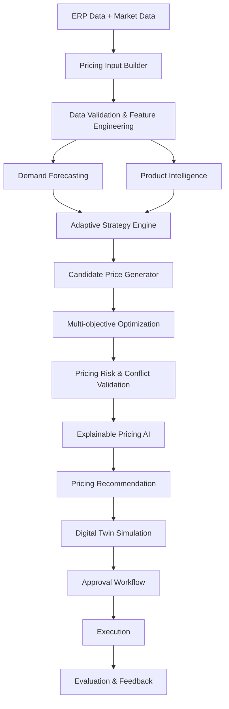

# WORK SPECIFICATION — LÊ MINH TÚ
## AI/ML & Pricing Optimization Engineer

**Dự án:** ERP Smart Pricing AI & BI V2  
**Vai trò:** AI/ML & Pricing Optimization Engineer  
**Phạm vi:** AI Pricing Engine, Optimization, Forecasting, Risk, Explainability & Simulation  
**Mục tiêu:** Xây dựng lõi trí tuệ định giá của hệ thống, biến dữ liệu ERP và thị trường thành các quyết định định giá có căn cứ, có thể giải thích, kiểm tra và mô phỏng trước khi thực thi.

---

## 1. Mục tiêu công việc

Lê Minh Tú chịu trách nhiệm xây dựng **Pricing Intelligence Engine** — lõi AI/thuật toán quyết định giá của hệ thống.

Engine không chỉ áp dụng công thức `Giá bán = Giá vốn + % lợi nhuận`, mà phải:

1. Phân tích dữ liệu sản phẩm, chi phí, tồn kho, doanh số và thị trường.
2. Xác định trạng thái hiện tại của sản phẩm.
3. Lựa chọn chiến lược định giá phù hợp.
4. Tạo nhiều mức giá ứng viên.
5. Đánh giá các mức giá theo nhiều mục tiêu.
6. Kiểm tra ràng buộc kinh doanh và rủi ro.
7. Chọn mức giá phù hợp trong phạm vi cho phép.
8. Giải thích tại sao chọn giá đó.
9. Mô phỏng tác động nếu áp dụng mức giá mới.
10. Lưu kết quả để phục vụ đánh giá hiệu quả AI.

## 2. Phạm vi module được giao

| # | Module | Mô tả |
|---|---|---|
| 01 | Adaptive Pricing Strategy Engine | Phân tích trạng thái sản phẩm và lựa chọn chiến lược định giá |
| 02 | Multi-objective Price Optimization | Đánh giá, xếp hạng và lựa chọn giá từ tập ứng viên |
| 03 | Demand Forecasting | Dự báo nhu cầu sản phẩm |
| 04 | Price Elasticity Analysis | Ước lượng mức ảnh hưởng của biến động giá đến nhu cầu |
| 05 | Adaptive Strategy Switching | Điều chỉnh chiến lược khi điều kiện sản phẩm thay đổi |
| 06 | Pricing Risk Engine | Đánh giá rủi ro của giá đề xuất |
| 07 | Pricing Conflict Detection | Phát hiện xung đột giữa mục tiêu, quy tắc và chiến lược |
| 08 | Explainable Pricing AI | Giải thích các yếu tố dẫn đến quyết định định giá |
| 09 | Pricing Digital Twin | Mô phỏng các kịch bản giá và tác động dự kiến |
| 10 | Pricing Experiment Lab | So sánh nhiều phương pháp định giá trên cùng dữ liệu |
| 11 | Closed-loop Evaluation | Đánh giá dự báo, mô phỏng và kết quả thực tế |

## 3. Kiến trúc module AI Pricing Engine



### 3.1. Cấu trúc module đề xuất

```text
pricing_engine/
├── __init__.py
├── config.py
├── schemas/
│   ├── input_schema.py
│   ├── output_schema.py
│   └── scenario_schema.py
├── core/
│   ├── pricing_pipeline.py
│   ├── feature_engineering.py
│   └── candidate_generator.py
├── strategies/
│   ├── base.py
│   ├── profit_maximization.py
│   ├── competitive_pricing.py
│   ├── inventory_clearance.py
│   ├── demand_capture.py
│   ├── premium_pricing.py
│   └── defensive_pricing.py
├── optimization/
│   ├── objective_function.py
│   ├── scoring.py
│   ├── constraints.py
│   └── optimizer.py
├── forecasting/
│   ├── demand_forecaster.py
│   ├── elasticity.py
│   └── evaluation.py
├── intelligence/
│   ├── product_state.py
│   ├── risk_engine.py
│   ├── conflict_detector.py
│   └── strategy_switching.py
├── explainability/
│   ├── explanation_engine.py
│   └── reason_builder.py
├── simulation/
│   ├── digital_twin.py
│   ├── scenario_engine.py
│   └── sensitivity_analysis.py
├── experiments/
│   ├── experiment_lab.py
│   ├── baseline_comparator.py
│   └── metrics.py
├── evaluation/
│   ├── closed_loop.py
│   ├── performance_tracker.py
│   └── model_metrics.py
└── tests/
    ├── test_strategy.py
    ├── test_optimizer.py
    ├── test_forecasting.py
    ├── test_risk.py
    ├── test_simulation.py
    └── test_pipeline.py
```

Đây là cấu trúc gợi ý. Có thể điều chỉnh theo repository thực tế nhưng cần giữ ranh giới logic rõ ràng và tránh gom toàn bộ thuật toán vào một file.

## 4. Module 01 — Adaptive Pricing Strategy Engine

### 4.1. Mục tiêu

Engine xác định trạng thái sản phẩm và chọn chiến lược định giá phù hợp thay vì áp dụng cùng một cách định giá cho mọi sản phẩm.

### 4.2. Các chiến lược cần hỗ trợ

| Strategy | Mục tiêu | Điều kiện tham khảo |
|---|---|---|
| Profit Maximization | Tối đa hóa lợi nhuận | Sản phẩm có nhu cầu và dữ liệu ổn định |
| Competitive Pricing | Duy trì vị thế cạnh tranh | Có dữ liệu giá đối thủ đáng tin cậy |
| Inventory Clearance | Giải phóng hàng tồn | Tồn kho cao, tuổi hàng lớn, bán chậm |
| Demand Capture | Tận dụng nhu cầu cao | Nhu cầu tăng, khả năng bán tốt |
| Premium Pricing | Duy trì định vị giá cao | Sản phẩm có lợi thế hoặc định vị premium |
| Defensive Pricing | Bảo vệ thị phần | Giá đối thủ biến động hoặc cạnh tranh mạnh |

### 4.3. Đầu vào

- Current selling price
- Cost price
- Current inventory
- Inventory aging
- Sales velocity
- Demand forecast
- Competitor price
- Competitor data confidence
- Product category
- Product lifecycle
- Channel fee
- Minimum margin
- Pricing rules

### 4.4. Logic baseline

```python
def select_strategy(product):
    if product["inventory_days"] >= 90 and product["sales_velocity"] < 0.3:
        return "INVENTORY_CLEARANCE"

    if product["demand_growth"] >= 0.2 and product["inventory"] < product["safety_stock"]:
        return "DEMAND_CAPTURE"

    if product["competitor_confidence"] >= 0.8:
        return "COMPETITIVE_PRICING"

    if product["product_position"] == "premium":
        return "PREMIUM_PRICING"

    return "PROFIT_MAXIMIZATION"
```

Đây chỉ là baseline ban đầu. Ngưỡng phải đưa vào config hoặc pricing rules, không hard-code rải rác.

### 4.5. Yêu cầu

- Giải thích được vì sao chọn chiến lược.
- Cho phép cấu hình điều kiện.
- Hỗ trợ fallback khi thiếu dữ liệu.
- Không để một chiến lược duy nhất xử lý mọi sản phẩm.
- Có thể đánh giá chiến lược sau khi có kết quả.

### 4.6. Output

```json
{
  "strategy": "INVENTORY_CLEARANCE",
  "strategy_reason": [
    "Inventory is above target",
    "Inventory aging is high",
    "Sales velocity is low"
  ],
  "confidence": 0.86
}
```

## 5. Module 02 — Multi-objective Pricing Optimization

### 5.1. Mục tiêu

Tìm giá bán phù hợp dựa trên nhiều mục tiêu kinh doanh, thay vì chỉ tìm giá cao nhất hoặc thấp nhất:

- Tối đa hóa lợi nhuận.
- Tối ưu doanh thu.
- Duy trì tính cạnh tranh.
- Cải thiện tình trạng tồn kho.
- Giảm rủi ro thay đổi giá.
- Bảo vệ biên lợi nhuận.

### 5.2. Candidate Price Generator

Engine tạo danh sách giá ứng viên để so sánh.

Ví dụ: giá hiện tại 100.000 VNĐ, giá sàn 85.000 VNĐ, giá đối thủ 95.000 VNĐ.

| Candidate | Giá |
|---|---:|
| P1 | 85.000 |
| P2 | 90.000 |
| P3 | 95.000 |
| P4 | 100.000 |
| P5 | 105.000 |
| P6 | 110.000 |
| P7 | 115.000 |

Candidate có thể sinh từ giá hiện tại, giá sàn, giá đối thủ, mức tăng/giảm theo phần trăm, chiến lược và pricing rule. Bước giá không bắt buộc cố định 5.000 VNĐ; cần cấu hình theo nhóm sản phẩm hoặc khoảng giá.

### 5.3. Hàm mục tiêu

Các thành phần chuẩn hóa về thang điểm 0–1:

\[
Score(p)=w_1Profit(p)+w_2Revenue(p)+w_3Competitive(p)+w_4Inventory(p)-w_5Risk(p)
\]

| Thành phần | Ý nghĩa |
|---|---|
| Profit | Điểm lợi nhuận |
| Revenue | Điểm doanh thu |
| Competitive | Mức độ cạnh tranh |
| Inventory | Mức độ phù hợp với tình trạng tồn kho |
| Risk | Rủi ro khi áp dụng giá |

Trọng số thay đổi theo chiến lược.

| Mục tiêu | Profit | Revenue | Competitive | Inventory | Risk |
|---|---:|---:|---:|---:|---:|
| Profit Maximization | 0.50 | 0.20 | 0.10 | 0.10 | 0.10 |
| Competitive Pricing | 0.25 | 0.15 | 0.40 | 0.10 | 0.10 |
| Inventory Clearance | 0.20 | 0.10 | 0.10 | 0.50 | 0.10 |
| Demand Capture | 0.35 | 0.30 | 0.15 | 0.10 | 0.10 |

Trọng số trên là cấu hình thử nghiệm, cần kiểm thử và điều chỉnh theo dữ liệu; không được coi là trọng số tối ưu đã được chứng minh.

### 5.4. Hard constraints

Các điều kiện bắt buộc không được scoring vượt qua:

- Giá không thấp hơn giá sàn.
- Không vi phạm minimum margin.
- Không tăng hoặc giảm quá giới hạn cho phép.
- Không vi phạm quy định của kênh bán hàng.
- Không sử dụng dữ liệu thị trường dưới ngưỡng confidence nếu chiến lược phụ thuộc dữ liệu đó.
- Không đưa candidate không hợp lệ vào recommendation cuối cùng.

### 5.5. Output

```json
{
  "current_price": 100000,
  "recommended_price": 95000,
  "strategy": "COMPETITIVE_PRICING",
  "candidate_prices": [
    {"price": 90000, "score": 0.71},
    {"price": 95000, "score": 0.86},
    {"price": 100000, "score": 0.74}
  ],
  "objective_breakdown": {
    "profit_score": 0.80,
    "revenue_score": 0.75,
    "competitive_score": 0.95,
    "inventory_score": 0.60,
    "risk_score": 0.15
  }
}
```

## 6. Module 03 — Demand Forecasting

### 6.1. Mục tiêu

Dự báo nhu cầu bán hàng để Pricing Engine có cơ sở đánh giá tác động của các mức giá khác nhau.

Đầu ra cần thể hiện:
- Số lượng sản phẩm có khả năng bán.
- Xu hướng nhu cầu.
- Mức tăng/giảm so với giai đoạn trước.
- Độ sai lệch dự báo.
- Độ tin cậy hoặc cảnh báo khi dữ liệu chưa đủ.

### 6.2. Dữ liệu đầu vào

- Product ID
- Ngày bán
- Số lượng bán
- Giá bán
- Doanh thu
- Lịch sử tồn kho
- Các thời điểm giá thay đổi
- Ngày lễ hoặc yếu tố thời gian (nếu có dữ liệu)

### 6.3. Phương pháp triển khai

Ưu tiên baseline dễ kiểm chứng trước:

| Phương pháp | Vai trò |
|---|---|
| Moving Average | Dự báo trung bình trượt |
| Weighted Moving Average | Ưu tiên dữ liệu gần hiện tại |
| Exponential Smoothing | Trọng số giảm dần theo thời gian |
| Linear Trend | Xác định xu hướng tăng/giảm |
| Random Forest Regressor | Thử mô hình phi tuyến khi dữ liệu đủ |

Không cần cố sử dụng mô hình phức tạp nếu dataset nhỏ.

### 6.4. Đánh giá

Bắt buộc hỗ trợ ít nhất MAE và RMSE. MAPE chỉ sử dụng khi dữ liệu không có giá trị thực bằng 0 hoặc có xử lý phù hợp. Phải so sánh mô hình với baseline đơn giản.

### 6.5. Output

```json
{
  "product_id": "SKU001",
  "forecast_horizon": 7,
  "predicted_demand": 84,
  "daily_forecast": [10, 11, 12, 12, 13, 13, 13],
  "trend": "INCREASING",
  "model_name": "MOVING_AVERAGE",
  "evaluation": {
    "mae": 2.1,
    "rmse": 2.8
  }
}
```

Nếu sử dụng dữ liệu demo hoặc mô phỏng, phải đánh dấu `simulated`. Không coi dữ liệu giả là dữ liệu thực tế để kết luận độ chính xác mô hình.

## 7. Module 04 — Price Elasticity Analysis

### 7.1. Mục tiêu

Phân tích mối quan hệ giữa giá bán và nhu cầu sản phẩm, nhằm trả lời:

- Khi tăng giá, lượng bán có giảm không?
- Khi giảm giá, lượng bán có tăng không?
- Mức độ nhạy cảm với giá cao hay thấp?
- Mức giá nào có khả năng mang lại lợi nhuận tốt hơn?

### 7.2. Công thức

\[
E_d=\frac{\%\Delta Q}{\%\Delta P}
\]

Trong đó \(E_d\) là độ co giãn cầu theo giá, \(\Delta Q\) là biến động lượng cầu và \(\Delta P\) là biến động giá.

Ví dụ: giá tăng 10%, lượng bán giảm 15%.

\[
E_d=\frac{-15\%}{10\%}=-1.5
\]

Điều này cho thấy nhu cầu có mức nhạy cảm khá cao với giá trong quan sát trên.

### 7.3. Phân loại

| Elasticity | Diễn giải |
|---|---|
| \(E_d<-1\) | Cầu co giãn mạnh |
| \(-1<E_d<0\) | Cầu ít co giãn |
| \(E_d\approx-1\) | Cầu co giãn đơn vị |
| \(E_d>0\) | Có thể có quan hệ đặc biệt, dữ liệu nhiễu hoặc vấn đề phân tích |

Không kết luận elasticity chỉ từ một cặp giá và lượng bán. Cần đủ quan sát, kiểm tra mùa vụ, khuyến mãi, tồn kho và các thay đổi nhu cầu.

### 7.4. Output

```json
{
  "product_id": "SKU001",
  "elasticity": -1.5,
  "elasticity_type": "ELASTIC",
  "observation_count": 24,
  "confidence": 0.72,
  "recommended_action": "PRICE_CHANGE_REQUIRES_EVALUATION"
}
```

Nếu dữ liệu chưa đủ, trả về `INSUFFICIENT_DATA`, không tự tạo elasticity giả.

## 8. Module 05 — Adaptive Strategy Switching

### 8.1. Mục tiêu

Không để sản phẩm luôn sử dụng chiến lược cố định khi điều kiện kinh doanh thay đổi. Engine đánh giá lại chiến lược theo từng lần chạy pricing.

| Trạng thái sản phẩm | Chiến lược hiện tại | Chiến lược đề xuất |
|---|---|---|
| Tồn kho thấp, cầu tăng | Profit Maximization | Demand Capture |
| Tồn kho cao, bán chậm | Competitive Pricing | Inventory Clearance |
| Giá đối thủ giảm mạnh | Profit Maximization | Competitive Pricing |
| Dữ liệu thị trường thiếu tin cậy | Competitive Pricing | Conservative Pricing |
| Sản phẩm premium, nhu cầu ổn định | Competitive Pricing | Premium Pricing |

### 8.2. Yêu cầu kỹ thuật

- Theo dõi chiến lược hiện tại.
- Đánh giá lại điều kiện chuyển chiến lược.
- Xác định chiến lược mới.
- Ghi lại lý do chuyển đổi.
- Hạn chế chuyển đổi liên tục giữa hai chiến lược.
- Có cooldown hoặc hysteresis.
- Có cấu hình mức thay đổi tối thiểu để kích hoạt chuyển đổi.
- Không tự thực thi giá khi chưa đi qua workflow được quy định.

### 8.3. Chống switching liên tục

Nếu chiến lược đang là Competitive Pricing, hệ thống không đổi sang Profit Maximization chỉ vì một tín hiệu nhỏ, rồi đổi ngược ngay sau lần chạy tiếp theo.

Cần có:
- Strategy threshold.
- Minimum strategy duration.
- Cooldown.
- Switching reason.
- Strategy history.

## 9. Module 06 — Pricing Risk Engine

### 9.1. Mục tiêu

Đánh giá rủi ro của đề xuất giá trước khi chuyển sang Approval Workflow.

### 9.2. Các nhóm rủi ro

| Risk | Kiểm tra |
|---|---|
| Margin Risk | Giá mới có làm biên lợi nhuận xuống thấp không? |
| Price Change Risk | Mức thay đổi so với giá hiện tại |
| Data Risk | Dữ liệu đầu vào có đủ tin cậy không? |
| Market Risk | Dữ liệu đối thủ có bất thường không? |
| Forecast Risk | Dự báo nhu cầu có sai số lớn không? |
| Inventory Risk | Có ảnh hưởng đến nguy cơ hết hàng hoặc tồn kho không? |
| Strategy Risk | Chiến lược có phù hợp trạng thái sản phẩm không? |
| Model Risk | Mô hình có thiếu dữ liệu hoặc kết quả không ổn định không? |

### 9.3. Risk Score

\[
RiskScore=\sum_{i=1}^{n}w_iR_i
\]

Các thành phần được chuẩn hóa về 0–100.

Trọng số khởi đầu:

| Risk factor | Weight |
|---|---:|
| Margin Risk | 0.30 |
| Data Risk | 0.20 |
| Price Change Risk | 0.20 |
| Forecast Risk | 0.15 |
| Market Risk | 0.10 |
| Inventory Risk | 0.05 |

Đây là cấu hình ban đầu để kiểm thử, không phải trọng số tối ưu đã xác thực.

### 9.4. Risk Levels

| Score | Level | Action |
|---|---|---|
| 0–29 | LOW | Có thể chuyển quy trình duyệt bình thường |
| 30–59 | MEDIUM | Cần cảnh báo và kiểm tra |
| 60–79 | HIGH | Yêu cầu review bổ sung |
| 80–100 | CRITICAL | Chặn tự động thực thi, yêu cầu xử lý |

### 9.5. Output

```json
{
  "risk_score": 68,
  "risk_level": "HIGH",
  "risk_factors": [
    {
      "code": "LOW_DATA_CONFIDENCE",
      "severity": "HIGH",
      "message": "Competitor data confidence is below threshold"
    },
    {
      "code": "HIGH_PRICE_CHANGE",
      "severity": "MEDIUM",
      "message": "Recommended price changes by 18%"
    }
  ],
  "requires_review": true,
  "execution_allowed": false
}
```

## 10. Module 07 — Pricing Conflict Detection

### 10.1. Mục tiêu

Phát hiện khi nhiều mục tiêu hoặc quy tắc cùng lúc đưa ra quyết định mâu thuẫn.

Ví dụ:
- Rule A yêu cầu giá thấp hơn đối thủ.
- Rule B yêu cầu margin tối thiểu 25%.
- Candidate Price thấp hơn giá đảm bảo margin.
- Strategy Clearance muốn giảm giá.
- Strategy Profit Maximization lại muốn tăng giá.

Engine phải phát hiện conflict thay vì âm thầm chọn một rule.

### 10.2. Conflict types

| Conflict Code | Mô tả |
|---|---|
| FLOOR_VIOLATION | Giá thấp hơn giá sàn |
| MIN_MARGIN_CONFLICT | Không đạt margin tối thiểu |
| STRATEGY_OBJECTIVE_CONFLICT | Mục tiêu chiến lược mâu thuẫn |
| MARKET_RULE_CONFLICT | Rule cạnh tranh mâu thuẫn với ràng buộc |
| CHANNEL_CONFLICT | Các kênh có điều kiện giá khác nhau |
| INVENTORY_STRATEGY_CONFLICT | Chiến lược không phù hợp tồn kho |
| PRICE_CHANGE_LIMIT | Thay đổi giá vượt giới hạn |

### 10.3. Output

```json
{
  "has_conflict": true,
  "conflicts": [
    {
      "code": "MIN_MARGIN_CONFLICT",
      "severity": "CRITICAL",
      "description": "Candidate price does not satisfy minimum margin",
      "affected_price": 85000,
      "required_minimum_price": 90000
    }
  ],
  "resolution": "REJECT_CANDIDATE"
}
```

## 11. Module 08 — Explainable Pricing AI

### 11.1. Mục tiêu

Mỗi đề xuất giá phải trả lời:
- Tại sao AI lựa chọn mức giá này?
- Chiến lược nào được sử dụng?
- Những yếu tố nào ảnh hưởng lớn nhất?
- Mức giá khác bị loại vì lý do gì?
- Rủi ro là gì?
- Mức độ tin cậy dữ liệu ra sao?

Không chấp nhận output chỉ có “AI đề xuất giá 95.000 VNĐ”.

### 11.2. Explanation structure

```json
{
  "summary": "Recommended price is 95,000 VND.",
  "strategy": "COMPETITIVE_PRICING",
  "positive_factors": [
    "Price is close to reliable competitor reference",
    "Expected margin remains above the minimum requirement"
  ],
  "negative_factors": [
    "Demand forecast has moderate uncertainty"
  ],
  "constraints_applied": [
    "Minimum margin",
    "Maximum price change"
  ],
  "rejected_candidates": [
    {
      "price": 85000,
      "reason": "Below minimum margin"
    }
  ],
  "decision_confidence": 0.84
}
```

### 11.3. Yêu cầu

- Explanation lấy từ kết quả Engine thực tế.
- Không hard-code lời giải thích không liên quan dữ liệu.
- Reason liên kết với input, feature, rule hoặc scoring.
- Phân biệt rule-based explanation và model-based explanation.
- Không tuyên bố sử dụng SHAP nếu chưa triển khai SHAP.

## 12. Module 09 — Pricing Digital Twin

### 12.1. Mục tiêu

Xây dựng môi trường mô phỏng định giá để doanh nghiệp thử các phương án giá trước khi áp dụng.

Người dùng chọn sản phẩm, thay đổi giá, thiết lập kịch bản và quan sát tác động dự kiến.

### 12.2. Scenario Simulation

Hỗ trợ:
- Giữ nguyên giá hiện tại.
- Tăng giá 5%.
- Giảm giá 5%.
- Giảm giá 10%.
- Định giá theo đối thủ.
- Định giá theo chiến lược AI.
- Nhập giá tùy chỉnh.

### 12.3. KPI mô phỏng

| KPI | Ý nghĩa |
|---|---|
| Estimated Demand | Số lượng bán dự kiến |
| Estimated Revenue | Doanh thu dự kiến |
| Estimated Profit | Lợi nhuận dự kiến |
| Estimated Margin | Biên lợi nhuận dự kiến |
| Inventory Remaining | Tồn kho còn lại dự kiến |
| Competitiveness | Mức độ cạnh tranh |
| Risk Score | Rủi ro của kịch bản |

### 12.4. Ví dụ

| Scenario | Price | Estimated Demand | Revenue | Profit |
|---|---:|---:|---:|---:|
| Baseline | 100.000 | 100 | 10.000.000 | 2.000.000 |
| Scenario A | 95.000 | 115 | 10.925.000 | 2.300.000 |
| Scenario B | 110.000 | 85 | 9.350.000 | 2.125.000 |
| Scenario C | 90.000 | 130 | 11.700.000 | 2.100.000 |

Số liệu minh họa, không phải kết quả thực tế hay bằng chứng giảm giá luôn tăng lợi nhuận.

### 12.5. Yêu cầu kỹ thuật

- Chạy nhiều scenario trong một request.
- Có Baseline để so sánh.
- KPI sử dụng chung công thức.
- Không làm thay đổi giá thật hoặc dữ liệu ERP.
- Lưu cấu hình scenario và kết quả simulation.
- Cho phép so sánh chênh lệch giữa các kịch bản.
- Có Sensitivity Analysis.

Sensitivity Analysis thử các mức giá (ví dụ 80.000–120.000, bước 2.000) để quan sát biến động profit, revenue và demand.

## 13. Module 10 — Pricing Experiment Lab

### 13.1. Mục tiêu

Xây dựng môi trường thử nghiệm và so sánh các phương pháp định giá khác nhau trên cùng dataset.

Phiên bản đồ án triển khai **offline experiment / backtesting / scenario comparison**, không phải A/B test trực tiếp trên khách hàng thật.

### 13.2. Các phương pháp cần so sánh

| Method | Mô tả |
|---|---|
| Baseline | Giữ nguyên giá hoặc phương pháp cơ bản |
| Rule-based | Áp dụng pricing rules |
| Competitor-based | Dựa trên giá đối thủ |
| Demand-based | Dựa trên nhu cầu |
| Adaptive Strategy | Lựa chọn chiến lược thích ứng |
| Optimized Pricing | Candidate scoring và optimization |

### 13.3. Chỉ số so sánh

- Estimated profit.
- Estimated revenue.
- Margin.
- Price competitiveness.
- Inventory impact.
- Risk score.
- Constraint violation rate.
- Price change magnitude.

### 13.4. Output

```json
{
  "experiment_id": "EXP001",
  "dataset_id": "DATASET_2026_01",
  "methods": [
    {
      "method": "BASELINE",
      "profit": 12000000,
      "revenue": 50000000
    },
    {
      "method": "COMPETITOR_BASED",
      "profit": 13200000,
      "revenue": 53000000
    },
    {
      "method": "ADAPTIVE_OPTIMIZATION",
      "profit": 14100000,
      "revenue": 54800000
    }
  ],
  "winner": "ADAPTIVE_OPTIMIZATION",
  "evaluation_type": "SIMULATED"
}
```

### 13.5. Yêu cầu

- Các method sử dụng cùng dataset.
- Cùng khoảng thời gian đánh giá.
- Cùng cost assumptions và constraints.
- Có thể tái chạy.
- Lưu experiment configuration.
- Không kết luận phương pháp tốt nhất dựa trên simulation chưa được xác thực.
- Có thể xuất kết quả cho BI phân tích.

## 14. Module 11 — Closed-loop Evaluation

### 14.1. Mục tiêu

Đánh giá đề xuất giá sau khi mô phỏng hoặc thực thi.


### 14.2. Thông tin theo dõi

- Recommendation ID.
- Product ID.
- Strategy.
- Recommended price.
- Predicted demand.
- Predicted revenue.
- Predicted profit.
- Actual price.
- Actual sales.
- Actual revenue.
- Actual profit nếu tính được.
- Prediction error.
- Evaluation timestamp.
- Model version.
- Data source.

### 14.3. Metrics

- MAE.
- RMSE.
- Forecast Bias.
- Revenue Difference.
- Profit Difference.
- Strategy Performance.
- Prediction Accuracy theo sản phẩm, ngành hàng hoặc chiến lược.

### 14.4. Feedback

Feedback được dùng để đánh giá chiến lược, xác định mô hình dự báo hoạt động tốt, phát hiện sai lệch, điều chỉnh rule/weight và xác định sản phẩm cần review.

Closed-loop Evaluation ở phiên bản đầu không tự động retrain hoặc điều chỉnh trọng số không kiểm soát. Feedback chỉ tạo thông tin đánh giá và hỗ trợ điều chỉnh có kiểm duyệt.

## 15. API mà module AI cần cung cấp

Pricing Engine cần được đóng gói thành service/API để frontend và các thành viên backend tích hợp.

| Method | Endpoint đề xuất | Chức năng |
|---|---|---|
| POST | `/api/ai/pricing/recommend` | Tạo đề xuất định giá |
| POST | `/api/ai/pricing/batch` | Chạy định giá nhiều sản phẩm |
| POST | `/api/ai/pricing/optimize` | Tối ưu giá |
| POST | `/api/ai/pricing/forecast` | Dự báo nhu cầu |
| POST | `/api/ai/pricing/elasticity` | Phân tích elasticity |
| POST | `/api/ai/pricing/simulate` | Chạy Digital Twin |
| POST | `/api/ai/pricing/experiments` | Tạo experiment |
| GET | `/api/ai/pricing/experiments/{id}` | Lấy kết quả experiment |
| POST | `/api/ai/pricing/evaluate` | Đánh giá kết quả dự báo |
| GET | `/api/ai/pricing/strategies` | Lấy danh sách strategy |
| GET | `/api/ai/pricing/recommendations/{id}` | Lấy chi tiết recommendation |

Các endpoint trên là contract đề xuất, chưa phải endpoint đã tồn tại. Cần thống nhất với backend lead trước khi triển khai để tránh trùng route hoặc sai schema.

## 16. Chuẩn dữ liệu đầu vào và đầu ra

### 16.1. Input contract

Pricing Engine nhận dữ liệu theo cấu trúc thống nhất, không phụ thuộc trực tiếp frontend.

```json
{
  "product": {
    "product_id": "SKU001",
    "product_name": "Wireless Mouse",
    "category": "Electronics",
    "current_price": 100000,
    "cost_price": 65000,
    "inventory_quantity": 120,
    "inventory_days": 95,
    "sales_velocity": 0.5,
    "product_lifecycle": "MATURE"
  },
  "market": {
    "competitor_price": 95000,
    "confidence_score": 0.92,
    "freshness_hours": 3,
    "source_reliability": 0.9
  },
  "sales": {
    "historical_sales": [10, 12, 15, 14, 18, 20, 17],
    "period_days": 7
  },
  "pricing_context": {
    "channel_fee_rate": 0.05,
    "min_margin": 0.15,
    "max_price_change_percent": 0.2
  },
  "objective": "BALANCED",
  "simulation": false
}
```

### 16.2. Output contract

```json
{
  "product_id": "SKU001",
  "current_price": 100000,
  "recommended_price": 95000,
  "price_change_percent": -5,
  "strategy": "COMPETITIVE_PRICING",
  "recommendation_status": "REVIEW_REQUIRED",
  "confidence": 0.84,
  "risk": {
    "score": 22,
    "level": "LOW"
  },
  "forecast": {
    "demand": 115,
    "model": "MOVING_AVERAGE"
  },
  "optimization": {
    "best_score": 0.86,
    "candidates_evaluated": 7
  },
  "explanation": {
    "summary": "Price selected to improve competitiveness while maintaining margin.",
    "reasons": [
      "Reliable competitor reference is available",
      "Price remains above minimum margin"
    ]
  },
  "constraints": {
    "floor_price": 85000,
    "min_margin_satisfied": true,
    "max_price_change_satisfied": true
  },
  "metadata": {
    "engine_version": "1.0.0",
    "evaluation_type": "SIMULATED"
  }
}
```

Schema trên là schema mục tiêu để phát triển, cần đồng bộ với database và backend team.

## 17. Phối hợp với các thành viên khác

| Thành viên | Tú nhận | Tú trả |
|---|---|---|
| Nguyễn Anh Minh — Backend | Request, auth context, workflow, pricing rules | Recommendation, risk, status, simulation result |
| Nghiêm Xuân Trường — Data | Competitor price, confidence, freshness, anomaly | Data validation requirements, kết quả đánh giá input |
| Trần Đức Trung — ERP | Cost, inventory, product, sales history, channel fee | Pricing signals, forecast request, optimized price |
| Nguyễn Thị Yên — BI | Data Mart, KPI, historical performance | Scoring, strategy, prediction, simulation, evaluation data |

### Nguyên tắc tích hợp

- Không tự tạo database schema trùng với ERP.
- Không truy cập database bằng truy vấn tùy tiện bên trong từng thuật toán.
- Dùng schema/interface đã thống nhất.
- AI Engine phải chạy độc lập được bằng test data.
- Recommendation có ID hoặc định danh để lưu lịch sử.
- Không gọi thực thi giá trực tiếp từ module AI.
- AI chỉ trả kết quả đề xuất, rủi ro, điều kiện và explanation.
- Quy trình duyệt/thực thi thuộc module backend workflow.

## 18. Kế hoạch triển khai theo giai đoạn

Với thời gian đồ án 4–6 tuần, không nên bắt đầu bằng tất cả module cùng lúc.

### Phase 1 — Core Pricing Engine (Tuần 1)

- [ ] Tạo cấu trúc module.
- [ ] Chuẩn hóa input/output schemas.
- [ ] Tạo Pricing Pipeline.
- [ ] Implement Price Floor.
- [ ] Implement Candidate Generator.
- [ ] Implement Pricing Rules.
- [ ] Implement baseline scoring.
- [ ] Unit test.

**Deliverable:** Pricing Engine chạy độc lập với JSON input, trả candidate và recommendation.

### Phase 2 — Adaptive Strategy & Optimization (Tuần 2)

- [ ] Implement 6 pricing strategies.
- [ ] Implement Strategy Selector.
- [ ] Implement strategy weights.
- [ ] Implement Multi-objective Scoring.
- [ ] Implement hard constraints.
- [ ] Implement Adaptive Strategy Switching.

**Deliverable:** Engine lựa chọn chiến lược và giá theo trạng thái sản phẩm.

### Phase 3 — AI Intelligence (Tuần 3)

- [ ] Demand Forecasting baseline.
- [ ] Price Elasticity baseline.
- [ ] Pricing Risk Engine.
- [ ] Pricing Conflict Detection.
- [ ] Explainable Pricing AI.

**Deliverable:** Recommendation có forecast, risk, conflict và explanation.

### Phase 4 — Simulation & Experiments (Tuần 4)

- [ ] Digital Twin.
- [ ] Scenario Engine.
- [ ] Sensitivity Analysis.
- [ ] Baseline Comparison.
- [ ] Experiment Lab.

**Deliverable:** Mô phỏng và so sánh nhiều chiến lược trên cùng dataset.

### Phase 5 — Integration & Evaluation (Tuần 5–6)

- [ ] FastAPI integration.
- [ ] Frontend integration.
- [ ] BI integration.
- [ ] Closed-loop Evaluation.
- [ ] End-to-end test.
- [ ] Performance & error handling.
- [ ] Chuẩn bị demo.

**Deliverable:** AI Pricing Engine tích hợp vào ERP Smart Pricing AI & BI V2.

## 19. Tiêu chí hoàn thành (Definition of Done)

Một module chỉ được coi là hoàn thành khi:

- [ ] Có code triển khai, không chỉ mock.
- [ ] Có input schema và output schema.
- [ ] Có xử lý dữ liệu thiếu hoặc không hợp lệ.
- [ ] Có unit test cho logic chính.
- [ ] Có ví dụ chạy được.
- [ ] Có log hoặc thông tin lỗi phù hợp.
- [ ] Có README mô tả cách sử dụng.
- [ ] Có thể tích hợp với pipeline tổng.
- [ ] Kết quả có thể kiểm tra và giải thích.
- [ ] Không dùng dữ liệu giả để tuyên bố hiệu quả thực tế.
- [ ] Được review và tích hợp vào nhánh chung.

## 20. Test cases tối thiểu

| Test | Input condition | Expected result |
|---|---|---|
| TC01 | Giá candidate dưới price floor | Candidate bị loại |
| TC02 | Giá không đạt min margin | Candidate bị loại hoặc conflict |
| TC03 | Tồn kho cao, hàng bán chậm | Ưu tiên Clearance nếu đủ điều kiện |
| TC04 | Nhu cầu tăng, tồn kho thấp | Có thể chọn Demand Capture |
| TC05 | Market confidence thấp | Cảnh báo hoặc fallback |
| TC06 | Giá thay đổi vượt limit | Risk/constraint violation |
| TC07 | Không có sales history | Forecast trả insufficient data hoặc fallback |
| TC08 | Dữ liệu sales có giá trị âm/invalid | Validation error |
| TC09 | Hai rule xung đột | Conflict Detection trả conflict |
| TC10 | Candidate bằng giá hiện tại | Không phát sinh price change sai |
| TC11 | Nhiều scenario cùng request | Trả đủ kết quả từng scenario |
| TC12 | Engine lỗi | Không trả recommendation giả; có error/fallback rõ ràng |

## 21. Giao diện UI do Tú phụ trách

Tú chịu trách nhiệm UI cho các chức năng AI Pricing, không chỉ làm backend.

| UI | Chức năng |
|---|---|
| AI Pricing Recommendation | Xem đề xuất giá, strategy, score và trạng thái |
| Candidate Price Comparison | So sánh các giá ứng viên |
| Strategy Intelligence | Xem chiến lược được lựa chọn và lý do |
| Optimization Center | Xem mục tiêu, trọng số, scoring và constraints |
| Demand Forecast | Biểu đồ dự báo nhu cầu |
| Pricing Risk Center | Risk score, risk factors, cảnh báo |
| AI Explanation Panel | Giải thích quyết định AI |
| Digital Twin Simulation | Thay đổi giá và chạy scenario |
| Experiment Lab | So sánh Baseline, Rule, Competitor, Adaptive |
| Evaluation Center | Xem predicted vs actual và hiệu suất model |

### Yêu cầu UI

- Không sử dụng dashboard chỉ gồm card số liệu.
- Recommendation phải thể hiện rõ giá hiện tại và giá đề xuất.
- Hiển thị mức tăng/giảm.
- Hiển thị strategy badge.
- Hiển thị scoring breakdown.
- Có bảng candidate.
- Có Risk indicators.
- Explanation phải đọc được, không chỉ JSON.
- Simulation phải có khả năng tương tác với giá.
- Phân biệt Actual, Predicted và Simulated.
- Loading, empty, error và insufficient data state đầy đủ.

## 22. Demo cần chuẩn bị

Chuẩn bị ít nhất 3 sản phẩm có trạng thái khác nhau để chứng minh engine hoạt động.

### Product A — High Demand / Low Inventory

- Nhu cầu cao.
- Tồn kho thấp.
- Giá đối thủ ổn định.

**Expected behavior:** Engine cân nhắc Demand Capture hoặc bảo vệ margin, không mặc định giảm giá.

### Product B — Overstock / Slow Moving

- Tồn kho lớn.
- Tuổi tồn kho cao.
- Sales velocity thấp.

**Expected behavior:** Engine cân nhắc Inventory Clearance, mô phỏng các mức giảm giá và tác động tồn kho/lợi nhuận.

### Product C — Strong Competitor Pressure

- Đối thủ có giá thấp.
- Market data confidence cao.
- Sản phẩm vẫn có margin room.

**Expected behavior:** Engine cân nhắc Competitive Pricing, đánh giá các candidate và chọn giá trong phạm vi constraints.

### Demo flow

1. Chọn sản phẩm.
2. Xem dữ liệu đầu vào.
3. Xem trạng thái sản phẩm.
4. Chạy AI Pricing.
5. Xem chiến lược được lựa chọn.
6. Xem danh sách candidate prices.
7. Xem scoring breakdown.
8. Xem risk và conflicts.
9. Xem explanation.
10. Chạy Digital Twin với nhiều scenario.
11. So sánh KPI.
12. Chuyển recommendation sang Approval Workflow.

## 23. Nguyên tắc kỹ thuật bắt buộc

1. Tách business logic và API layer.
2. Không hard-code threshold, weight hoặc pricing rule.
3. Có config cho strategy và optimization.
4. Không để AI bỏ qua hard constraints.
5. Không dùng dữ liệu thị trường thiếu confidence mà không cảnh báo.
6. Không để module AI tự thay đổi giá thật.
7. Không coi simulation là actual result.
8. Có baseline trước khi sử dụng ML phức tạp.
9. Có metrics để đánh giá model.
10. Có logging, versioning và reproducibility.
11. Có unit test.
12. Có thể chạy engine độc lập.
13. Có README hướng dẫn.
14. Đồng bộ API contract với team.
15. Tích hợp liên tục, không chờ cuối dự án mới ghép.

## 24. Thứ tự ưu tiên thực hiện

### P0 — Bắt buộc hoàn thành

- [ ] Pricing Pipeline
- [ ] Price Floor & Margin
- [ ] Candidate Generator
- [ ] 6 Strategy baseline
- [ ] Multi-objective Scoring
- [ ] Hard Constraints
- [ ] Recommendation Output
- [ ] Risk Engine baseline
- [ ] Explanation Engine baseline
- [ ] API integration
- [ ] Unit tests

### P1 — Hoàn thành khi Core ổn định

- [ ] Demand Forecasting
- [ ] Adaptive Strategy Switching
- [ ] Conflict Detection
- [ ] Digital Twin
- [ ] Sensitivity Analysis
- [ ] Experiment Lab
- [ ] Closed-loop Evaluation

### P2 — Nâng cao nếu còn thời gian

- [ ] Advanced forecasting
- [ ] Advanced elasticity model
- [ ] XGBoost comparison
- [ ] Model drift analysis
- [ ] Advanced experiment evaluation
- [ ] Advanced optimization algorithms

Không triển khai P2 trước khi P0 chạy ổn định và tích hợp được.

## 25. Kết quả cuối cùng cần bàn giao

Lê Minh Tú phải bàn giao:

- [ ] Source code AI Pricing Engine.
- [ ] Strategy modules.
- [ ] Optimization modules.
- [ ] Forecasting modules.
- [ ] Risk & Conflict modules.
- [ ] Explainability modules.
- [ ] Simulation modules.
- [ ] Experiment modules.
- [ ] Evaluation modules.
- [ ] API endpoints hoặc service contract.
- [ ] Unit tests.
- [ ] Test dataset.
- [ ] README kỹ thuật.
- [ ] Tài liệu thuật toán.
- [ ] UI AI Pricing.
- [ ] Demo 3 sản phẩm.
- [ ] Báo cáo kết quả evaluation.
- [ ] Tài liệu tích hợp với backend, ERP, market data và BI.

## 26. Định nghĩa thành công của module

Module AI Pricing của Lê Minh Tú được xem là đạt yêu cầu khi hệ thống có thể nhận dữ liệu sản phẩm, tồn kho, chi phí, lịch sử bán hàng và dữ liệu thị trường; đánh giá trạng thái sản phẩm; lựa chọn chiến lược; tạo và chấm điểm nhiều mức giá; kiểm tra ràng buộc và rủi ro; đưa ra recommendation có giải thích; mô phỏng các kịch bản; đồng thời cung cấp kết quả có cấu trúc để backend thực hiện quy trình duyệt, BI phân tích và nhóm đánh giá hiệu quả.

> **Mục tiêu cuối cùng: Xây dựng một Pricing Engine có khả năng ra quyết định dựa trên dữ liệu và thuật toán, có thể kiểm chứng, giải thích và mô phỏng — không phải một hệ thống chỉ tính giá bằng các công thức cố định.**
